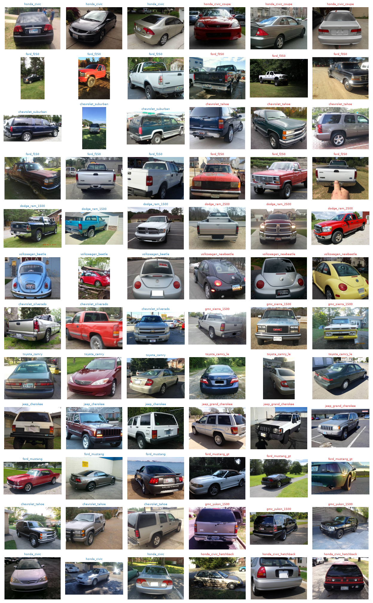

# Car make, model & generation classification with DINOv3

Identifying a car's **make, model and generation** (e.g. *Honda Civic 2001–2005*) from a single photo, using
frozen [DINOv3](https://github.com/facebookresearch/dinov3) image embeddings on the
[VMMRdb](https://github.com/faezetta/VMMRdb) dataset (281,752 photos, 9,166 make/model/year classes).

No neural network was fine-tuned. DINOv3 is used as a fixed feature extractor, and everything on top of it
trains in under a minute on a laptop.

## Results

All numbers are on a held-out test set of 56,042 images that was never used for training or for building
year buckets.

| Task | Classes | Nearest neighbor | Linear classifier | MLP classifier |
|---|---:|---:|---:|---:|
| **Make + model** (`honda_civic`) | 834 | 89.0% | 90.7% | **91.9%** |
| **Make + model + year bucket** (`honda_civic_2001-2005`) | 2,118 | 84.8% | 88.7% | **89.1%** |
| Make + model + exact year (`honda_civic_2003`) | 4,481 | 42.4% | 49.4% | – |

- **Make only:** about 98% correct for every approach.
- **Top-5:** the bucket MLP has the right answer in its top 5 guesses 98.3% of the time.
- **Year buckets fix the year problem.** Predicting the exact year tops out around 49%, because neighbouring
  years of the same generation look identical. Grouping those years into data-driven buckets raises accuracy
  to 89%. When the classifier gets the car right, it picks the right generation about 97% of the time.

## What was done

### 0. Embeddings (`embed.py`)

Each image is resized to 256×256 and passed through the pretrained **DINOv3 ViT-L/16** (303M parameters,
`dinov3_vitl16_pretrain_lvd1689m`). Its 1024-dim output embedding is saved and L2-normalized. This is the only
expensive step: about 2h40m for the full dataset on an Apple M-series GPU (MPS).

### 1. Honest evaluation (`probe.py`, step 1)

Early experiments (in `notebooks/`) matched every image against the whole dataset, including other photos of
the same car. To get a trustworthy number:

- Classes with fewer than 10 images are dropped. That keeps 99.5% of images at the make+model level.
- The rest is split into **train 72% / validation 8% / test 20%**, stratified so every class appears in each
  split.
- Each test image is matched only against train and validation images, using cosine similarity with
  [FAISS](https://github.com/facebookresearch/faiss).
- **Leakage check.** 20% of test images have a near-copy in train (similarity ≥ 0.95), probably other photos
  from the same online listing. Removing them only drops accuracy from 89.0% to 88.1%, so the model really is
  recognizing cars, not memorizing photos.

### 2. Classifier on frozen embeddings (`probe.py`, step 2)

A small classifier is trained on the saved embeddings. You can choose a single linear layer, or an MLP with
one 2048-unit hidden layer.

- **Training:** AdamW with a one-cycle learning-rate schedule, label smoothing 0.1, 30 epochs, keeping the
  epoch with the best validation accuracy.
- **Speed:** about 10–50 seconds per run.
- **Result:** it beats nearest-neighbor matching on every task.

### 3. Data-driven year buckets (`year_buckets.py`)

Most cars keep the same look for several years, so a car's year can't be read from a photo, only its
generation can. Instead of hand-entering generation dates for 1,175 models, the buckets are found from the
embeddings:

1. For each model, compare each year's photos with the previous year's.
2. Similarity is **sample-size corrected**: average cross-year similarity divided by average within-year
   similarity. Unchanged years score about 1.00, whether they have 5 photos or 500.
3. When similarity drops below **0.95**, the car was redesigned, so a new bucket starts.
4. Years with fewer than 5 training photos can't start a bucket; they join the nearest one.
5. Only **training images** are used, so the test set stays untouched.

The detected boundaries match the real generation changes:

```
honda_civic    … 1996-2000, 2001-2005, 2006-2011, 2012, 2013-2015, 2016
toyota_camry   … 1997-2001, 2002-2006, 2007-2011, 2012-2014, 2015
ford_mustang   … 1994-1998, 1999-2004, 2005-2009, 2010-2014, 2015-2016
```

It also separates visible mid-generation facelifts (e.g. Civic 2012 vs. 2013–2015). The full mapping is in
[`year_buckets.json`](year_buckets.json). The median bucket covers 4 years.

### 4. Error analysis (`probe.py`)

For the bucket MLP, the 6,093 test errors break down as:

| Error type | Share |
|---|---:|
| Wrong make | 15% |
| Right make, wrong model | 59% |
| Right model, wrong year bucket | 26% |

The most-confused model pairs (full list printed by `probe.py`, every error in
[`analysis/errors_bucket_mlp.csv`](analysis/errors_bucket_mlp.csv)) are almost all cases where the photo alone
isn't enough, or the labels overlap:

- **Overlapping dataset labels for the same car.** VMMRdb names trims and body styles inconsistently:
  `honda_civic` vs `honda_civic_coupe`, `toyota_camry` vs `toyota_camry_le`, `ford_mustang` vs
  `ford_mustang_gt`, `volkswagen_beetle` vs `volkswagen_newbeetle`, `dodge_neon` vs `plymouth_neon`.
- **Rebadged twins** sold under different brands with near-identical bodies: Chevrolet Silverado / GMC Sierra,
  Tahoe / Yukon, Subaru Legacy / Outback.
- **Same body, different engine or payload rating:** Ford F-250 / F-350, Ram 1500 / 2500 / 3500,
  BMW 325i / 328i, Mercedes S430 / S500.

Only a couple of the top 25 pairs (e.g. Jeep Cherokee vs. Grand Cherokee) are cars that actually look
different.



## Conclusions

- **Frozen DINOv3 is enough.** Pretrained embeddings plus a small classifier reach about 92% make+model and
  89% make+model+generation accuracy, with no fine-tuning.
- **Years need buckets.** Exact year isn't learnable from photos; data-driven generation buckets are, and
  they line up with real model generations.
- **The remaining errors are mostly label problems.** Rebadged twins were kept as separate classes on purpose,
  so some errors are expected and unavoidable.
- **Fine-tuning was not pursued.** It's estimated at about $5 per run on a cloud H100, or about 20 hours on
  an M5 Pro. It can't resolve overlapping labels or near-identical twins, so the expected gain is small.
  Merging overlapping label names would be the cheapest next improvement.

## Repository layout

```
embed.py              Step 0: DINOv3 embeddings for every image  -> data/
probe.py              Steps 1-2: train/test split, kNN eval, linear/MLP classifier, error analysis
year_buckets.py       Data-driven year buckets per model         -> year_buckets.json
common.py             Shared paths and label helpers
year_buckets.json     Every make_model_year label -> its bucket
analysis/             Error CSVs and confused-pair photo grids
notebooks/            Original exploration (sample-size experiments, first full-dataset kNN)
```

`data/`, `splits/`, `checkpoints/` and `dinov3/` are git-ignored because they're large or can be regenerated.

## Reproducing

```bash
pip install -r requirements.txt

# 0. Embeddings (about 2h40m). Needs the VMMRdb images, a clone of the DINOv3 repo,
#    and the ViT-L/16 weights (request access through the DINOv3 repo).
git clone https://github.com/facebookresearch/dinov3.git
python embed.py --dataset /path/to/VMMRdb --repo ./dinov3 \
    --weights /path/to/dinov3_vitl16_pretrain_lvd1689m-8aa4cbdd.pth

# 1-2. Make + model: split, kNN evaluation, classifier (about 30s)
python probe.py
python probe.py --head mlp

# 3. Year buckets, then make + model + generation
python year_buckets.py
python probe.py --target bucket --head mlp

# Exact year, for comparison
python probe.py --target label
```

Useful options: `--min-images`, `--head {linear,mlp}`, `--skip-knn`, `--skip-probe` (`probe.py`), and
`--threshold`, where higher means more, narrower buckets (`year_buckets.py`). Run any script with `--help` for
the full list.

## Early exploration

The notebooks record the first experiments: nearest-neighbor matching on random samples of 1,000 and 10,000
images, then on the full dataset.

| Sample | Make + model | Make |
|---|---:|---:|
| 1,000 images | 48.3% | 69.6% |
| 10,000 images | 77.6% | 92.4% |
| Full dataset | 89.2% | 97.8% |

Small samples score low mainly because most images have no other photo of the same class to match against.
These early numbers had no train/test separation; the results tables above replace them.
